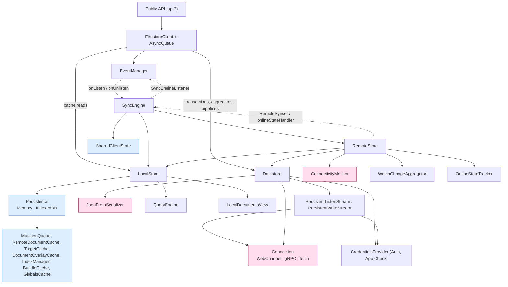

# How the Firebase JS SDK layers its Firestore client

Research for [#260](https://github.com/VisioLab/effect-firebase/issues/260), under the map [#259 Effect-native Firestore engine](https://github.com/VisioLab/effect-firebase/issues/259).

**Question.** What does each internal layer of `@firebase/firestore` do, what does each depend on, and where does the SDK swap implementations per platform (browser, Node, React Native) or per cache mode (memory, IndexedDB)?

**Source.** `firebase/firebase-js-sdk` at commit [`23bc734`](https://github.com/firebase/firebase-js-sdk/tree/23bc734c5f7d19903d4bb27efe6a48ce7b28a784/packages/firestore) (`@firebase/firestore` 4.20.0). Every claim links to a file and line range at that commit. Paths below are relative to `packages/firestore/`.

## Summary

The full SDK is a stack of seven layers, wired once by two component providers and serialised through one `AsyncQueue`:

```
Public API  →  FirestoreClient  →  EventManager  →  SyncEngine  ─┬→  LocalStore  →  Persistence (+ caches)
                                                                 └→  RemoteStore →  Datastore  →  Connection
```

- **Two seams carry all variability.** The _platform_ seam is a build-time module alias that swaps `src/platform/<name>/*.ts` (Connection, serializer, base64, DOM, random bytes, …). The _cache_ seam is a runtime choice of `OfflineComponentProvider` (memory eager, memory LRU, IndexedDB single-tab, IndexedDB multi-tab).
- **The Connection is the only transport abstraction.** WebChannel (browser, RN), gRPC (Node) and `fetch` (the Lite SDK) all implement one five-member interface. Everything above it is transport-agnostic.
- **The Datastore adds credentials and proto (de)serialisation** on top of a Connection; the **RemoteStore** adds reliability (stream lifecycle, resume, write pipeline, online state).
- **The LocalStore never knows whether storage is durable.** It runs everything through `Persistence.runTransaction`; memory mutators ignore the transaction.
- **Not everything goes through the cache.** Transactions, aggregations and pipelines call the Datastore directly, and the Lite SDK has only Datastore + Connection.

## 1. Layer reference

Each entry gives the layer's job, what it depends on, and its interface to the layers next to it.

### 1.1 Connection (`remote/connection.ts`)

**Job.** A "connected RPC interface to a remote Datastore": send unary RPCs, server-streaming RPCs, and open bidirectional streams. It explicitly does _not_ queue RPCs while the connection is down ([connection.ts L22-35][conn-doc]).

**Interface** ([connection.ts L36-106][conn-iface]):

| Member                                                                       | Purpose                                                                         |
| ---------------------------------------------------------------------------- | ------------------------------------------------------------------------------- |
| `invokeRPC(rpcName, path, request, authToken, appCheckToken): Promise<Resp>` | Unary RPC (`Commit`, `BatchGetDocuments`, …).                                   |
| `invokeStreamingRPC(..., expectedResponseCount?): Promise<Resp[]>`           | Server-streaming RPC collected into an array (`RunQuery`, `BatchGetDocuments`). |
| `openStream(rpcName, authToken, appCheckToken): Stream<Req, Resp>`           | Bidirectional stream (`Listen`, `Write`).                                       |
| `shouldResourcePathBeIncludedInRequest`                                      | Whether the resource path goes in the body (gRPC) or the URL (REST).            |
| `terminate()`                                                                | Release resources.                                                              |

`Stream<I, O>` is callback-shaped: `onConnected`, `onOpen`, `onClose(err?)`, `onMessage`, `send`, `close`; `onClose` is guaranteed to fire ([connection.ts L108-126][conn-stream]). `StreamBridge` is a helper that adapts transport events to this interface ([stream_bridge.ts L24-104][stream-bridge]).

Messages are plain JS objects shaped like the REST/JSON request, or the input to the protobuf stubs for gRPC ([connection.ts L31-34][conn-doc]).

**Depends on.** `DatabaseInfo` (host, ssl, project/database ids, `forceLongPolling`, `autoDetectLongPolling`, API key, custom headers) and `Token` from the credentials module. Nothing above it.

**Implementations.**

| Class                                         | File                                           | Transport                                                                                                                                                                                                                                                                                                                                                                                                                                                  |
| --------------------------------------------- | ---------------------------------------------- | ---------------------------------------------------------------------------------------------------------------------------------------------------------------------------------------------------------------------------------------------------------------------------------------------------------------------------------------------------------------------------------------------------------------------------------------------------------- |
| `RestConnection` (abstract)                   | [rest_connection.ts L62-215][rest]             | Builds URLs `…/v1/{path}:{method}` from a fixed RPC-name→REST-method map ([L43-49][rest-map]), sets headers (`google-cloud-resource-prefix`, `x-goog-request-params`, `X-Goog-Api-Client`, auth/App Check token headers, `Content-Type: text/plain` to avoid CORS preflight) ([L154-192][rest]). `invokeStreamingRPC` just calls `invokeRPC`, because REST aggregates the stream ([L130-149][rest]). Leaves `openStream` and `performRPCRequest` abstract. |
| `WebChannelConnection extends RestConnection` | [webchannel_connection.ts L79-511][webchannel] | Unary RPCs over closure `XhrIo` ([L119-215][webchannel-xhr]); `openStream` over `@firebase/webchannel-wrapper` WebChannel with `httpSessionIdParam: 'gsessionid'`, long-polling options, headers as `initMessageHeaders`, bridged through `StreamBridge` ([L216-450][webchannel-stream]).                                                                                                                                                                  |
| `FetchConnection extends RestConnection`      | [fetch_connection.ts L29-90][fetch]            | Unary RPCs over `fetch` POST; `openStream` throws `'Not supported by FetchConnection'` ([L30-35][fetch]). Used only by the Lite SDK.                                                                                                                                                                                                                                                                                                                       |
| `GrpcConnection implements Connection`        | [grpc_connection.ts L93-376][grpc]             | `@grpc/grpc-js` stub built from bundled `protos.json` via `@grpc/proto-loader` ([load_protos.ts L45, L67][protos]); SSL or insecure channel credentials ([L117-136][grpc]); tokens go into `grpc.Metadata` ([L43-91][grpc]); `shouldResourcePathBeIncludedInRequest` is `true` because the stub ignores `path` ([L101-104][grpc]).                                                                                                                         |

### 1.2 ConnectivityMonitor (`remote/connectivity_monitor.ts`)

**Job.** Tells the RemoteStore when the OS network status changes, so it can restart streams ([connectivity_monitor.ts L23-44][cm]; consumer at [remote_store.ts L180-197][rs-ctor]).

**Implementations.** `BrowserConnectivityMonitor` listens to `window` `online`/`offline` events ([browser/connectivity_monitor.ts L33-80][cm-browser]); `NoopConnectivityMonitor` everywhere else (Node always, browser when `window.addEventListener` is missing) ([browser/connection.ts L32-38][p-browser-conn], [node/connection.ts L33-35][p-node-conn]).

### 1.3 Serializer (`remote/serializer.ts`)

**Job.** Converts model objects (documents, mutations, targets, watch changes) to and from the wire JSON. One class, `JsonProtoSerializer(databaseId, useProto3Json)`, with one switch: Proto3 JSON (REST/WebChannel) or protobuf.js object form (gRPC) ([serializer.ts L157-175][serializer]). The flag changes encoding of timestamps, bytes, int64 etc. ([L195, L224, L261, L275][serializer-flag]).

**Depends on.** `DatabaseId` only. It is shared by Datastore (wire format) and the local serializer (IndexedDB stores protos) ([component_provider.ts L132-137][cp-memory]).

### 1.4 Datastore (`remote/datastore.ts`)

**Job.** "A wrapper around the external Google Cloud Datastore grpc API" that is convenient for the rest of the SDK ([datastore.ts L66-75][ds-abstract]). Concretely:

- Fetches auth and App Check tokens before every RPC, and on `UNAUTHENTICATED` invalidates both tokens ([L103-170][ds-invoke]).
- Wraps non-Firestore errors as `UNKNOWN` ([L120-133][ds-invoke]).
- Exposes one free function per RPC that serialises the request and deserialises the response: `invokeCommitRpc`, `invokeBatchGetDocumentsRpc`, `invokeExecutePipeline`, `invokeRunQueryRpc`, `invokeRunAggregationQueryRpc` ([L194-370][ds-rpcs]).
- Constructs the two persistent streams, handing them the Connection, both credential providers and the serializer ([L374-406][ds-streams]).

**Depends on.** `Connection`, `JsonProtoSerializer`, `CredentialsProvider<User>`, `CredentialsProvider<string>` (App Check) ([L80-91][ds-impl]). The `Datastore` abstract class itself exposes only `serializer` and `terminate()`; the RPC functions are free functions so they tree-shake ([L71-74][ds-abstract]).

### 1.5 PersistentStream, ListenStream, WriteStream (`remote/persistent_stream.ts`)

**Job.** A streaming RPC with the features a client needs on top of `Connection.openStream`: exponential backoff, credential fetch on each start, dispatch of all callbacks onto the `AsyncQueue`, and closing after 60 s idle ([persistent_stream.ts L150-181][ps-doc]).

**State machine.** `Initial → Starting → Open → Healthy`, `Error → Backoff → Starting`; any state → `Initial` on `stop()` or idle timeout ([L61-121][ps-states]). A stream counts as `Healthy` after 10 s open; an `UNAUTHENTICATED` close before that invalidates both tokens, `RESOURCE_EXHAUSTED` sets backoff to max, and any message received resets backoff ([L145-148][ps-timeouts], [L378-405, L505-530][ps-start], [L663-668][ps-listen]).

**Subclasses.**

- `PersistentListenStream` opens `'Listen'`, turns each response into a `WatchChange` plus snapshot version; `watch(targetData)` / `unwatch(targetId)` send add/remove target requests ([L626-706][ps-listen]). Listener: `onOpen`, `onClose`, `onWatchChange` ([L608-624][ps-listen-listener]).
- `PersistentWriteStream` opens `'Write'`, performs a handshake to get a stream token, then sends mutation batches; responses carry commit version and per-mutation results ([L741-885][ps-write]). Listener adds `onHandshakeComplete` and `onMutationResult` ([L707-739][ps-write-listener]).

**Depends on.** `AsyncQueue`, `Connection`, both credential providers, serializer, `ExponentialBackoff` ([backoff.ts L43][backoff]).

### 1.6 RemoteStore (`remote/remote_store.ts`)

**Job** ([remote_store.ts L84-103][rs-doc]):

- Keep the connection to the backend: the set of active listens, reconnect on drop, resume all listens on reconnect.
- Turn watch stream messages into `RemoteEvent`s (via `WatchChangeAggregator`) and notify SyncEngine.
- Pull pending mutations from LocalStore, send them on the write stream, retry on network failure, ack or reject to SyncEngine.

**State it owns** ([L112-205][rs-impl]): `writePipeline` (up to `MAX_PENDING_WRITES = 10` batches; responses are matched by order), `listenTargets`, the watch and write streams, `WatchChangeAggregator`, `offlineCauses` (user-disabled, IndexedDB failure, secondary tab, credential change, connectivity change, shutdown — [L69-82][rs-offline]), `OnlineStateTracker`. At this commit it also keeps a map between SDK target ids and remote target ids ([L145-151][rs-impl], [L280-300][rs-targetmap]).

**Interfaces.**

- _Downward:_ `Datastore` (streams via `newPersistentWatchStream` / `newPersistentWriteStream`, created lazily in `ensureWatchStream` / `ensureWriteStream`, [L1141-1229][rs-ensure]).
- _Sideways to LocalStore:_ `localStoreGetNextMutationBatch` to fill the pipeline ([L885-933][rs-fill]), `localStoreGetLastRemoteSnapshotVersion` and target metadata for watch handling ([L604-670][rs-watchchange]).
- _Upward:_ the `RemoteSyncer` callback object, which SyncEngine fills in: `applyRemoteEvent`, `rejectListen`, `applySuccessfulWrite`, `rejectFailedWrite`, `getRemoteKeysForTarget`, `handleCredentialChange` ([remote_syncer.ts L30-76][remote-syncer]). Online state goes up through an `onlineStateHandler` callback passed at construction ([L172-205][rs-ctor]).

**Helpers in `remote/`.**

- `WatchChangeAggregator` accumulates `DocumentWatchChange`, `WatchTargetChange` (`NoChange`/`Added`/`Removed`/`Current`/`Reset`) and `ExistenceFilterChange` into a `RemoteEvent`, handling bloom-filter existence filters; it reads target state through a `TargetMetadataProvider` (`getRemoteKeysForTarget`, `getTargetDataForTarget`, `getDatabaseId`) ([watch_change.ts L55-117, L267-293, L293-880][watch]).
- `RemoteEvent` / `TargetChange` are the output of a watch snapshot ([remote_event.ts L36-130][remote-event]).
- `OnlineStateTracker` derives `Unknown`/`Online`/`Offline` from watch stream starts and failures (offline after 1 failure or 10 s without success) ([online_state_tracker.ts L31-37, L50-140][online]).

### 1.7 LocalStore (`local/local_store_impl.ts`)

**Job.** The local query and write engine. It owns per-user components and exposes free functions (tree-shakeable) for every local operation ([local_store_impl.ts L127-232][ls-impl]):

- Writes: `localStoreWriteLocally` (append to mutation queue, compute overlays, return changed docs), `localStoreAcknowledgeBatch`, `localStoreRejectBatch`, `localStoreGetNextMutationBatch` ([L318-535, L899][ls-fns]).
- Watch: `localStoreApplyRemoteEventToLocalCache`, `localStoreAllocateTarget` / `ReleaseTarget`, `localStoreGetLastRemoteSnapshotVersion`, resume tokens buffered up to 5 min ([L96-103, L550-1086][ls-fns]).
- Reads: `localStoreExecuteQuery`, `localStoreReadDocument`, `localStoreGetDocuments` ([L923, L1087-1175, L1252][ls-fns]).
- User change: `localStoreHandleUserChange` swaps mutation queue, overlay cache and index manager to the new user ([L258-317][ls-fns], [L211-231][ls-impl]).
- Bundles, field indexes, GC ([L1343-1606][ls-fns]).

**Depends on.** `Persistence` (and through it every cache), `QueryEngine`, the initial `User`, the serializer ([L196-210][ls-impl]). It requires `persistence.started` ([L202-205][ls-impl]).

**Internal parts.**

- `LocalDocumentsView` — the latency-compensated view: remote documents with mutation overlays applied ([local_documents_view.ts L80-87][ldv]).
- `QueryEngine` — runs a query locally using field indexes if any, else the target→keys mapping from a previous sync, else a full collection scan; documents when the shortcut is unsafe ([query_engine.ts L95-124][qe]).

### 1.8 Persistence and its caches (`local/persistence.ts`)

**Job.** "The lowest-level shared interface to persistent storage". A factory for the caches plus `runTransaction(action, mode, op)`; modes are `readonly`, `readwrite`, `readwrite-primary` ([persistence.ts L100-259][persistence], [persistence_transaction.ts L24-47][ptxn]). Writes are only durable once the transaction's `PersistencePromise` resolves; memory implementations "are free to ignore the transaction", which lets LocalStore stay unaware of durability ([L105-133][persistence]).

**Cache interfaces it hands out** (all take a `PersistenceTransaction` and return `PersistencePromise`):

| Interface                         | Holds                                                                                            | File                                        |
| --------------------------------- | ------------------------------------------------------------------------------------------------ | ------------------------------------------- |
| `MutationQueue` (per user)        | Pending local write batches: add, lookup, next after id, affecting key/query, remove             | [mutation_queue.ts L30-175][mq]             |
| `RemoteDocumentCache`             | Last-known server documents with read times; change buffers                                      | [remote_document_cache.ts L41-125][rdc]     |
| `TargetCache`                     | `TargetData` per query, target→document keys, last remote snapshot version, target id allocation | [target_cache.ts L34-195][tc]               |
| `DocumentOverlayCache` (per user) | Precomputed result of pending mutations per document                                             | [document_overlay_cache.ts L36-115][doc-ov] |
| `IndexManager` (per user)         | Collection-parent index, client-side field indexes                                               | [index_manager.ts L63-200][im]              |
| `BundleCache`                     | Bundle metadata and named queries                                                                | [bundle_cache.ts L30-65][bc]                |
| `GlobalsCache`                    | Session token                                                                                    | [globals_cache.ts L31-50][gc]               |
| `ReferenceDelegate`               | Reference counting for GC (eager or LRU)                                                         | [persistence.ts L61-99][persistence]        |

`PersistencePromise` is a synchronous re-implementation of Promise; it exists because IndexedDB auto-commits a transaction if control returns to the event loop ([persistence_promise.ts L28-40][pp]).

### 1.9 SyncEngine (`core/sync_engine_impl.ts`)

**Job.** "The central controller … the glue code between the EventManager, LocalStore, and RemoteStore": coordinate client requests with remote events, keep a `View` per query, and tell RemoteStore when there are new mutations to send ([sync_engine.ts L18-38][se-doc]).

**State** ([sync_engine_impl.ts L202-266][se-impl]): `queryViewsByQuery`, `queriesByTarget`, limbo resolution queues and maps (bounded by `maxConcurrentLimboResolutions`, 100 from `FirestoreClient` — [firestore_client.ts L110][fc-limbo]), user write callbacks per user and batch id, pending-writes callbacks, `onlineState`, `isPrimaryClient`.

**Interfaces.**

- _Down to LocalStore:_ `localStoreWriteLocally`, `localStoreApplyRemoteEventToLocalCache`, `localStoreAllocateTarget`, … (e.g. write path [L532-561][se-write]).
- _Down to RemoteStore:_ `remoteStoreListen` / `remoteStoreUnlisten`, `fillWritePipeline` ([L532-561][se-write]).
- _Up from RemoteStore:_ fills `remoteStore.remoteSyncer` lazily — watch callbacks in `ensureWatchCallbacks`, write callbacks in `syncEngineEnsureWriteCallbacks` ([L1670-1695][se-callbacks]).
- _Up to EventManager:_ `SyncEngineListener` with `onWatchChange(snapshots)` and `onWatchError(query, error)` ([L178-187][se-listener], bound at [L1678-1681][se-callbacks]).
- _Sideways to SharedClientState:_ pending mutations, target states and online state for multi-tab ([L257-265][se-impl], [L532-545][se-write]).

**View** (`core/view.ts`). Per-query document set, limbo documents, `mutatedKeys`, `current` flag; `computeDocChanges` / `applyChanges` / `applyOnlineStateChange` produce `ViewSnapshot`s ([view.ts L81-560][view]).

### 1.10 EventManager (`core/event_manager.ts`)

**Job.** Maps queries to listeners and fans out: identical queries share one backend watch ([event_manager.ts L57-79][em-doc]). Holds `QueryListener`s per query, applies listen options (metadata changes, `source: 'cache'`), raises `snapshotsInSync` events ([L84-155, L399-590][em]).

**Interface.** Downward calls are optional function slots — `onListen`, `onUnlisten`, `onFirstRemoteStoreListen`, `onLastRemoteStoreUnlisten` — which `FirestoreClient.getEventManager` binds to SyncEngine functions on first use ([L66-79][em-doc], [firestore_client.ts L393-416][fc-em]). Upward it calls user `Observer`s ([L52-64][em-doc]). Inputs from SyncEngine: `eventManagerOnWatchChange`, `eventManagerOnWatchError`, `eventManagerOnOnlineStateChange` ([L283-345][em]).

### 1.11 SharedClientState (`local/shared_client_state.ts`)

**Job.** Multi-tab coordination: pending mutation ids, query target state, online state, active clients ([shared_client_state.ts L79-190][scs]). `WebStorageSharedClientState` uses `localStorage` events ([L482-1105][scs]); `MemorySharedClientState` is a no-op for single-client setups ([L1106-1187][scs]).

### 1.12 FirestoreClient and the AsyncQueue (`core/firestore_client.ts`, `util/async_queue.ts`)

**FirestoreClient** "constructs and owns all of the pieces of the client SDK architecture" and the shared `AsyncQueue` ([firestore_client.ts L117-222][fc]). It starts both credential providers on the queue, builds a `ComponentConfiguration` (queue, `DatabaseInfo`, credentials, client id, initial user, limbo limit) ([L139-185][fc]), and lazily initialises offline then online components on first use ([L320-375][fc-ensure]). Credential changes route to `localStoreHandleUserChange` before the online components exist, and to `remoteStoreHandleCredentialChange` after ([L224-280][fc-set]).

It routes operations to different layers ([L457-645][fc-ops]):

| Operation                                        | Path                                                                                                                                                                                                                |
| ------------------------------------------------ | ------------------------------------------------------------------------------------------------------------------------------------------------------------------------------------------------------------------- |
| `onSnapshot`, `getDoc`/`getDocs` from server     | EventManager → SyncEngine (listen)                                                                                                                                                                                  |
| `getDocFromCache` / `getDocsFromCache`           | LocalStore directly                                                                                                                                                                                                 |
| `setDoc`, `updateDoc`, `deleteDoc`, `WriteBatch` | SyncEngine `syncEngineWrite`                                                                                                                                                                                        |
| `runTransaction`                                 | `TransactionRunner` → `Transaction` → Datastore (`BatchGetDocuments`, `Commit`) — bypasses LocalStore and SyncEngine ([L627-645][fc-ops], [transaction.ts L29-41][txn], [transaction_runner.ts L33-50][txn-runner]) |
| aggregations, pipelines                          | Datastore directly ([L540-580][fc-ops])                                                                                                                                                                             |

**AsyncQueue** serialises all internal work and owns timers: `enqueue`, `enqueueAndForget`, `enqueueRetryable` (for IndexedDB failures), `enqueueAfterDelay(timerId, …)`, restricted mode for shutdown ([async_queue.ts L214-280][aq]). Every layer that schedules work or callbacks takes it.

### 1.13 Credentials (`api/credentials.ts`)

`CredentialsProvider<T>` with `start(asyncQueue, changeListener)`, `getToken()`, `invalidateToken()`, `shutdown()` ([credentials.ts L106-128][cred]). `T = User` for Auth, `T = string` for App Check. Implementations: empty, emulator, Lite, Firebase Auth, first-party (Gapi), App Check ([L135-420][cred]). Tokens are opaque header maps (`Token.headers`) consumed by the Connection ([L68-82][cred], [rest_connection.ts L170-176][rest]).

## 2. How layers are wired: the component providers

`core/component_provider.ts` is the composition root. It splits the graph into an **offline** half and an **online** half ([component_provider.ts L80-108, L405-511][cp]).

**`OfflineComponentProvider`** builds: `serializer` → `SharedClientState` → `Persistence` (started) → `LocalStore` → GC scheduler → index backfiller scheduler ([L132-146][cp-memory]). Each step is an overridable `create*` method.

**`OnlineComponentProvider`** takes the offline components and builds: `Datastore` (new serializer + `newConnection(databaseInfo)` + both credentials) → `RemoteStore` (LocalStore, Datastore, queue, online-state callback into SyncEngine, `newConnectivityMonitor()`) → `EventManager` → `SyncEngine` (LocalStore, RemoteStore, EventManager, SharedClientState, user, limbo limit, primary flag) ([L425-459, L461-503][cp-online]). It then wires the late-bound callbacks: SharedClientState online state → SyncEngine, `remoteSyncer.handleCredentialChange` → SyncEngine, and applies primary state to RemoteStore ([L444-458][cp-online]).

The cycle RemoteStore ⇄ SyncEngine is broken by construction order plus mutable callback slots (`remoteSyncer`, `onlineStateHandler`), not by interfaces passed to constructors.

## 3. Per-platform swaps

### 3.1 Mechanism

Code imports platform functions from `src/platform/<module>` (e.g. `import { newConnection } from '../platform/connection'`). At build time Rollup's alias plugin rewrites `…/platform/<module>` to `…/platform/<target>/<module>.ts` ([rollup.shared.cjs L63-72][alias]). Under ts-node (tests) the shim files `require` `./${TEST_PLATFORM ?? 'node'}/<module>` instead ([platform/connection.ts][p-conn-shim], [platform/serializer.ts][p-ser-shim]).

Build targets: `browser` and `node` and `rn` for the full SDK ([rollup.config.js L112, L128, L270][rollup]); `browser_lite`, `node_lite`, `rn_lite` for the Lite SDK ([rollup.config.lite.js L76, L101, L253][rollup-lite]). `package.json` `exports` picks the bundle by `node` / `react-native` / `browser` condition ([package.json L68-127][pkg]).

### 3.2 What each platform supplies

| Module                                                                                               | browser                              | node                               | rn                             | browser_lite      | node_lite         | rn_lite         |
| ---------------------------------------------------------------------------------------------------- | ------------------------------------ | ---------------------------------- | ------------------------------ | ----------------- | ----------------- | --------------- |
| `connection.newConnection`                                                                           | `WebChannelConnection`               | `GrpcConnection` (loads protos)    | = browser                      | `FetchConnection` | `FetchConnection` | = browser_lite  |
| `connection.newConnectivityMonitor`                                                                  | `BrowserConnectivityMonitor` or noop | noop                               | = browser                      | = browser         | = browser         | = browser_lite  |
| `serializer.newSerializer`                                                                           | `useProto3Json = true`               | `useProto3Json = false`            | = browser                      | = browser         | = browser_lite    | = browser_lite  |
| `dom` (`getWindow`, `getDocument`)                                                                   | globals                              | `null` (unless mock persistence)   | = browser                      | = browser         | = node            | = rn            |
| `base64`, `random_bytes`, `text_serializer`, `format_json`, `byte_stream_reader`, `snapshot_to_json` | Web APIs                             | `Buffer`, `crypto`, `util.inspect` | mostly = browser; own `base64` | own / re-export   | own / re-export   | own / re-export |

Sources: [browser/connection.ts][p-browser-conn], [node/connection.ts][p-node-conn], [rn/connection.ts][p-rn-conn], [browser_lite/connection.ts][p-blite-conn], [node_lite/connection.ts][p-nlite-conn], [rn_lite/connection.ts][p-rnlite-conn], [browser/serializer.ts][p-browser-ser], [node/serializer.ts][p-node-ser], [rn/serializer.ts][p-rn-ser]. Node and RN differ from browser in one more place: the entry points call `registerFirestore('node')` and `registerFirestore('rn', /* useFetchStreams= */ false)` ([index.node.ts][idx-node], [index.rn.ts L20][idx-rn], [register.ts L35-66][register]). `useFetchStreams` ends up in `DatabaseInfo` ([database_info.ts L39-51][dbinfo]) but no file under `src/platform/` reads it at this commit.

Only the Connection, the serializer flag and the DOM handles reach the layer graph; everything else is utility code. IndexedDB persistence needs `getWindow()` / `getDocument()` for visibility and `localStorage` ([component_provider.ts L292-314][cp-idb], [indexeddb_persistence.ts L245-249][idb]).

### 3.3 The Lite SDK

The Lite SDK has no FirestoreClient, LocalStore, SyncEngine, EventManager or streams. `getDatastore(firestore)` builds `newConnection` + `newSerializer` + `newDatastore` and the Lite API calls the `invoke*Rpc` functions directly ([lite-api/components.ts L65-90][lite]). With `FetchConnection` this is the REST-only shape: unary and server-streaming RPCs, no `openStream`.

## 4. Per-cache-mode swaps

### 4.1 Selection

`FirestoreSettings.localCache` carries a pair of provider factories; `configureFirestore` copies them into `_componentsProvider` and hands them to `FirestoreClient` ([database.ts L293-330][db-configure]). With no setting the client uses `LruGcMemoryOfflineComponentProvider` ([firestore_client.ts L344-348][fc-ensure]). The deprecated `enableIndexedDbPersistence` / `enableMultiTabIndexedDbPersistence` set the same slot ([database.ts L372-470][db-configure]).

| Public setting                                                          | Offline provider                      | Persistence                                 | GC                                          | SharedClientState             |
| ----------------------------------------------------------------------- | ------------------------------------- | ------------------------------------------- | ------------------------------------------- | ----------------------------- |
| _(none)_, `memoryLocalCache()`, `memoryLruGarbageCollector()`           | `LruGcMemoryOfflineComponentProvider` | `MemoryPersistence` + `MemoryLruDelegate`   | `LruScheduler`                              | Memory                        |
| `memoryLocalCache({ garbageCollector: memoryEagerGarbageCollector() })` | `MemoryOfflineComponentProvider`      | `MemoryPersistence` + `MemoryEagerDelegate` | none (eager)                                | Memory                        |
| `persistentLocalCache({ tabManager: persistentSingleTabManager() })`    | `IndexedDbOfflineComponentProvider`   | `IndexedDbPersistence`                      | `LruScheduler` + `IndexBackfillerScheduler` | Memory                        |
| `persistentLocalCache({ tabManager: persistentMultipleTabManager() })`  | `MultiTabOfflineComponentProvider`    | `IndexedDbPersistence` (`synchronizeTabs`)  | same                                        | `WebStorageSharedClientState` |

Sources: [cache_config.ts L48-70, L174-226, L308-395][cache-config]; [component_provider.ts L116-403][cp].

All four use the same `OnlineComponentProvider`. The IndexedDB providers also initialise the online components eagerly, re-enqueue writes from a previous session and start the write pipeline, and gate GC and index backfill on the primary lease ([component_provider.ts L239-264][cp-idb]). If the IndexedDB provider fails with a recoverable error, `FirestoreClient` falls back to `MemoryOfflineComponentProvider` ([firestore_client.ts L282-343][fc-ensure]).

### 4.2 Memory vs IndexedDB, side by side

| Concern              | `MemoryPersistence`                                                                                              | `IndexedDbPersistence`                                                                                                                     |
| -------------------- | ---------------------------------------------------------------------------------------------------------------- | ------------------------------------------------------------------------------------------------------------------------------------------ |
| Caches               | `Memory*` classes, mutation queue and overlay cache keyed by user in maps ([memory_persistence.ts L67-170][mem]) | `IndexedDb*` classes over `SimpleDb` object stores, per-user via `forUser` ([indexeddb_persistence.ts L715-780][idb-caches])               |
| `runTransaction`     | Creates a `MemoryTransaction` with a sequence number and runs the op; not transactional ([L173-211][mem])        | Opens a `SimpleDb` transaction over the needed object stores; `readwrite-primary` checks the primary lease ([L782-840][idb-caches])        |
| Reference delegate   | `MemoryEagerDelegate` (drop unreferenced docs at commit) or `MemoryLruDelegate` ([L224-530][mem])                | `IndexedDbLruDelegateImpl` ([L230][idb])                                                                                                   |
| Process model        | Single client                                                                                                    | Primary lease in an `owner` store refreshed every 4 s, zombie marker in `localStorage`, `visibilitychange` listener ([L98, L117-165][idb]) |
| Storage of documents | Model objects                                                                                                    | Protos via `LocalSerializer` (uses the remote serializer)                                                                                  |

The interfaces in §1.8 are the whole seam: LocalStore code is identical for both.

## 5. Dependency diagram

Arrows point from a component to what it calls or holds. Dashed arrows are late-bound callback slots.



Pink nodes swap per platform (build-time alias); blue nodes swap per cache mode (runtime provider). Everything else is shared code.

## 6. Data flows through the stack

**Write.** `setDoc` → `firestoreClientWrite` → `syncEngineWrite` → `localStoreWriteLocally` (mutation queue + overlays, in a persistence transaction) → views re-emit with `hasPendingWrites` → `fillWritePipeline` pulls batches from LocalStore → `PersistentWriteStream.writeMutations` → `onMutationResult` → `remoteSyncer.applySuccessfulWrite` → `localStoreAcknowledgeBatch` → user promise resolves ([sync_engine_impl.ts L532-561][se-write], [remote_store.ts L885-1045][rs-fill]).

**Listen.** `onSnapshot` → `eventManagerListen` → `syncEngineListen` → `localStoreAllocateTarget` + `localStoreExecuteQuery` → `View` → first snapshot from cache → `remoteStoreListen` → `PersistentListenStream.watch` → `WatchChange`s → `WatchChangeAggregator.createRemoteEvent` at each global snapshot → `remoteSyncer.applyRemoteEvent` → `localStoreApplyRemoteEventToLocalCache` → `View.applyChanges` → `eventManagerOnWatchChange` → `QueryListener` → user observer ([remote_store.ts L357-416, L604-808][rs-watchchange], [sync_engine_impl.ts L301-443, L567-626][se-listen]).

**Transaction.** `runTransaction` → `TransactionRunner` (backoff, `maxAttempts`, retries only non-permanent errors) → `Transaction` reads with `BatchGetDocuments` and commits with `Commit` on the Datastore. No LocalStore, no latency compensation ([transaction_runner.ts L33-130][txn-runner]).

## Implications for the native engine

Facts from the SDK that bear on the layer design in #259. No decisions.

1. **One transport interface covers all three transports.** The SDK's `Connection` is unary + server-streaming + bidi stream + a "path in body or URL" flag. WebChannel, gRPC and fetch all fit it; `fetch` leaves `openStream` unimplemented.
2. **REST and WebChannel share a base.** URL building, header assembly and the RPC-name→REST-method map live in `RestConnection`; WebChannel only adds the stream and an XHR unary path. The serializer differs only by `useProto3Json`, true for every REST/WebChannel platform and false for gRPC.
3. **Credentials sit at the Datastore and stream boundary, not in the Connection.** Tokens are fetched per RPC and per stream start, passed to the Connection as opaque header maps, and invalidated on `UNAUTHENTICATED`. A user change restarts streams (RemoteStore) and swaps per-user caches (LocalStore).
4. **Reliability is a separate layer above transport.** Backoff, idle close, health timer, write pipeline ordering, resume tokens, online-state derivation and limbo resolution are all transport-agnostic and live in PersistentStream / RemoteStore / SyncEngine.
5. **The cache seam is narrow and transaction-shaped.** Seven cache interfaces plus `runTransaction(mode)` and a reference delegate. Memory implementations ignore the transaction; the IndexedDB ones need synchronous continuation (`PersistencePromise`), a primary lease and DOM handles.
6. **The memory cache is not a separate code path.** The SDK always runs LocalStore, the mutation queue and overlays, even with memory persistence; latency compensation and offline writes therefore work the same in both modes.
7. **Some operations bypass the cache entirely.** Transactions, aggregations and pipelines go straight to the Datastore; the Lite SDK is Datastore + Connection only. An admin-style engine has a precedent for a "no LocalStore" composition.
8. **Composition is a two-phase root with late-bound callbacks.** Offline components first, online second; the RemoteStore ⇄ SyncEngine and EventManager ⇄ SyncEngine cycles are closed by mutable callback slots after construction.
9. **Platform selection is build-time aliasing, cache selection is runtime.** gRPC stays out of browser bundles because the alias never resolves `platform/node/*` in a browser build.
10. **One serial queue orders everything.** All callbacks, timers and network events are funnelled through `AsyncQueue`, which also owns the timer ids used by backoff and idle timeouts.

## Open points

- The SDK-to-remote target-id mapping in RemoteStore ([remote_store.ts L145-151][rs-impl]) is recent and its purpose is not documented in the source; it was not traced further.
- `useFetchStreams` is still threaded into `DatabaseInfo` but has no reader in `src/platform/` at this commit; whether it is dead or read elsewhere (e.g. inside `@firebase/webchannel-wrapper` options) was not settled.

<!-- Permalinks at commit 23bc734 -->

[conn-doc]: https://github.com/firebase/firebase-js-sdk/blob/23bc734c5f7d19903d4bb27efe6a48ce7b28a784/packages/firestore/src/remote/connection.ts#L22-L35
[conn-iface]: https://github.com/firebase/firebase-js-sdk/blob/23bc734c5f7d19903d4bb27efe6a48ce7b28a784/packages/firestore/src/remote/connection.ts#L36-L106
[conn-stream]: https://github.com/firebase/firebase-js-sdk/blob/23bc734c5f7d19903d4bb27efe6a48ce7b28a784/packages/firestore/src/remote/connection.ts#L108-L126
[stream-bridge]: https://github.com/firebase/firebase-js-sdk/blob/23bc734c5f7d19903d4bb27efe6a48ce7b28a784/packages/firestore/src/remote/stream_bridge.ts#L24-L104
[rest]: https://github.com/firebase/firebase-js-sdk/blob/23bc734c5f7d19903d4bb27efe6a48ce7b28a784/packages/firestore/src/remote/rest_connection.ts#L62-L215
[rest-map]: https://github.com/firebase/firebase-js-sdk/blob/23bc734c5f7d19903d4bb27efe6a48ce7b28a784/packages/firestore/src/remote/rest_connection.ts#L43-L49
[webchannel]: https://github.com/firebase/firebase-js-sdk/blob/23bc734c5f7d19903d4bb27efe6a48ce7b28a784/packages/firestore/src/platform/browser/webchannel_connection.ts#L79-L511
[webchannel-xhr]: https://github.com/firebase/firebase-js-sdk/blob/23bc734c5f7d19903d4bb27efe6a48ce7b28a784/packages/firestore/src/platform/browser/webchannel_connection.ts#L119-L215
[webchannel-stream]: https://github.com/firebase/firebase-js-sdk/blob/23bc734c5f7d19903d4bb27efe6a48ce7b28a784/packages/firestore/src/platform/browser/webchannel_connection.ts#L216-L450
[fetch]: https://github.com/firebase/firebase-js-sdk/blob/23bc734c5f7d19903d4bb27efe6a48ce7b28a784/packages/firestore/src/platform/browser_lite/fetch_connection.ts#L29-L90
[grpc]: https://github.com/firebase/firebase-js-sdk/blob/23bc734c5f7d19903d4bb27efe6a48ce7b28a784/packages/firestore/src/platform/node/grpc_connection.ts#L43-L376
[protos]: https://github.com/firebase/firebase-js-sdk/blob/23bc734c5f7d19903d4bb27efe6a48ce7b28a784/packages/firestore/src/platform/node/load_protos.ts#L40-L70
[cm]: https://github.com/firebase/firebase-js-sdk/blob/23bc734c5f7d19903d4bb27efe6a48ce7b28a784/packages/firestore/src/remote/connectivity_monitor.ts#L23-L44
[cm-browser]: https://github.com/firebase/firebase-js-sdk/blob/23bc734c5f7d19903d4bb27efe6a48ce7b28a784/packages/firestore/src/platform/browser/connectivity_monitor.ts#L33-L80
[serializer]: https://github.com/firebase/firebase-js-sdk/blob/23bc734c5f7d19903d4bb27efe6a48ce7b28a784/packages/firestore/src/remote/serializer.ts#L157-L175
[serializer-flag]: https://github.com/firebase/firebase-js-sdk/blob/23bc734c5f7d19903d4bb27efe6a48ce7b28a784/packages/firestore/src/remote/serializer.ts#L190-L280
[ds-abstract]: https://github.com/firebase/firebase-js-sdk/blob/23bc734c5f7d19903d4bb27efe6a48ce7b28a784/packages/firestore/src/remote/datastore.ts#L66-L75
[ds-impl]: https://github.com/firebase/firebase-js-sdk/blob/23bc734c5f7d19903d4bb27efe6a48ce7b28a784/packages/firestore/src/remote/datastore.ts#L80-L101
[ds-invoke]: https://github.com/firebase/firebase-js-sdk/blob/23bc734c5f7d19903d4bb27efe6a48ce7b28a784/packages/firestore/src/remote/datastore.ts#L103-L178
[ds-rpcs]: https://github.com/firebase/firebase-js-sdk/blob/23bc734c5f7d19903d4bb27efe6a48ce7b28a784/packages/firestore/src/remote/datastore.ts#L194-L370
[ds-streams]: https://github.com/firebase/firebase-js-sdk/blob/23bc734c5f7d19903d4bb27efe6a48ce7b28a784/packages/firestore/src/remote/datastore.ts#L374-L406
[ps-doc]: https://github.com/firebase/firebase-js-sdk/blob/23bc734c5f7d19903d4bb27efe6a48ce7b28a784/packages/firestore/src/remote/persistent_stream.ts#L150-L181
[ps-states]: https://github.com/firebase/firebase-js-sdk/blob/23bc734c5f7d19903d4bb27efe6a48ce7b28a784/packages/firestore/src/remote/persistent_stream.ts#L61-L121
[ps-timeouts]: https://github.com/firebase/firebase-js-sdk/blob/23bc734c5f7d19903d4bb27efe6a48ce7b28a784/packages/firestore/src/remote/persistent_stream.ts#L145-L148
[ps-start]: https://github.com/firebase/firebase-js-sdk/blob/23bc734c5f7d19903d4bb27efe6a48ce7b28a784/packages/firestore/src/remote/persistent_stream.ts#L360-L560
[ps-listen]: https://github.com/firebase/firebase-js-sdk/blob/23bc734c5f7d19903d4bb27efe6a48ce7b28a784/packages/firestore/src/remote/persistent_stream.ts#L626-L706
[ps-listen-listener]: https://github.com/firebase/firebase-js-sdk/blob/23bc734c5f7d19903d4bb27efe6a48ce7b28a784/packages/firestore/src/remote/persistent_stream.ts#L608-L624
[ps-write]: https://github.com/firebase/firebase-js-sdk/blob/23bc734c5f7d19903d4bb27efe6a48ce7b28a784/packages/firestore/src/remote/persistent_stream.ts#L741-L885
[ps-write-listener]: https://github.com/firebase/firebase-js-sdk/blob/23bc734c5f7d19903d4bb27efe6a48ce7b28a784/packages/firestore/src/remote/persistent_stream.ts#L707-L739
[backoff]: https://github.com/firebase/firebase-js-sdk/blob/23bc734c5f7d19903d4bb27efe6a48ce7b28a784/packages/firestore/src/remote/backoff.ts#L43
[rs-doc]: https://github.com/firebase/firebase-js-sdk/blob/23bc734c5f7d19903d4bb27efe6a48ce7b28a784/packages/firestore/src/remote/remote_store.ts#L84-L110
[rs-offline]: https://github.com/firebase/firebase-js-sdk/blob/23bc734c5f7d19903d4bb27efe6a48ce7b28a784/packages/firestore/src/remote/remote_store.ts#L66-L82
[rs-impl]: https://github.com/firebase/firebase-js-sdk/blob/23bc734c5f7d19903d4bb27efe6a48ce7b28a784/packages/firestore/src/remote/remote_store.ts#L112-L205
[rs-ctor]: https://github.com/firebase/firebase-js-sdk/blob/23bc734c5f7d19903d4bb27efe6a48ce7b28a784/packages/firestore/src/remote/remote_store.ts#L172-L221
[rs-targetmap]: https://github.com/firebase/firebase-js-sdk/blob/23bc734c5f7d19903d4bb27efe6a48ce7b28a784/packages/firestore/src/remote/remote_store.ts#L280-L355
[rs-fill]: https://github.com/firebase/firebase-js-sdk/blob/23bc734c5f7d19903d4bb27efe6a48ce7b28a784/packages/firestore/src/remote/remote_store.ts#L885-L1045
[rs-watchchange]: https://github.com/firebase/firebase-js-sdk/blob/23bc734c5f7d19903d4bb27efe6a48ce7b28a784/packages/firestore/src/remote/remote_store.ts#L357-L808
[rs-ensure]: https://github.com/firebase/firebase-js-sdk/blob/23bc734c5f7d19903d4bb27efe6a48ce7b28a784/packages/firestore/src/remote/remote_store.ts#L1141-L1229
[remote-syncer]: https://github.com/firebase/firebase-js-sdk/blob/23bc734c5f7d19903d4bb27efe6a48ce7b28a784/packages/firestore/src/remote/remote_syncer.ts#L26-L76
[watch]: https://github.com/firebase/firebase-js-sdk/blob/23bc734c5f7d19903d4bb27efe6a48ce7b28a784/packages/firestore/src/remote/watch_change.ts#L55-L880
[remote-event]: https://github.com/firebase/firebase-js-sdk/blob/23bc734c5f7d19903d4bb27efe6a48ce7b28a784/packages/firestore/src/remote/remote_event.ts#L36-L130
[online]: https://github.com/firebase/firebase-js-sdk/blob/23bc734c5f7d19903d4bb27efe6a48ce7b28a784/packages/firestore/src/remote/online_state_tracker.ts#L31-L140
[ls-impl]: https://github.com/firebase/firebase-js-sdk/blob/23bc734c5f7d19903d4bb27efe6a48ce7b28a784/packages/firestore/src/local/local_store_impl.ts#L127-L238
[ls-fns]: https://github.com/firebase/firebase-js-sdk/blob/23bc734c5f7d19903d4bb27efe6a48ce7b28a784/packages/firestore/src/local/local_store_impl.ts#L96-L1606
[ldv]: https://github.com/firebase/firebase-js-sdk/blob/23bc734c5f7d19903d4bb27efe6a48ce7b28a784/packages/firestore/src/local/local_documents_view.ts#L80-L87
[qe]: https://github.com/firebase/firebase-js-sdk/blob/23bc734c5f7d19903d4bb27efe6a48ce7b28a784/packages/firestore/src/local/query_engine.ts#L88-L124
[persistence]: https://github.com/firebase/firebase-js-sdk/blob/23bc734c5f7d19903d4bb27efe6a48ce7b28a784/packages/firestore/src/local/persistence.ts#L61-L268
[ptxn]: https://github.com/firebase/firebase-js-sdk/blob/23bc734c5f7d19903d4bb27efe6a48ce7b28a784/packages/firestore/src/local/persistence_transaction.ts#L24-L47
[pp]: https://github.com/firebase/firebase-js-sdk/blob/23bc734c5f7d19903d4bb27efe6a48ce7b28a784/packages/firestore/src/local/persistence_promise.ts#L28-L40
[mq]: https://github.com/firebase/firebase-js-sdk/blob/23bc734c5f7d19903d4bb27efe6a48ce7b28a784/packages/firestore/src/local/mutation_queue.ts#L30-L175
[rdc]: https://github.com/firebase/firebase-js-sdk/blob/23bc734c5f7d19903d4bb27efe6a48ce7b28a784/packages/firestore/src/local/remote_document_cache.ts#L41-L125
[tc]: https://github.com/firebase/firebase-js-sdk/blob/23bc734c5f7d19903d4bb27efe6a48ce7b28a784/packages/firestore/src/local/target_cache.ts#L34-L195
[doc-ov]: https://github.com/firebase/firebase-js-sdk/blob/23bc734c5f7d19903d4bb27efe6a48ce7b28a784/packages/firestore/src/local/document_overlay_cache.ts#L36-L115
[im]: https://github.com/firebase/firebase-js-sdk/blob/23bc734c5f7d19903d4bb27efe6a48ce7b28a784/packages/firestore/src/local/index_manager.ts#L63-L200
[bc]: https://github.com/firebase/firebase-js-sdk/blob/23bc734c5f7d19903d4bb27efe6a48ce7b28a784/packages/firestore/src/local/bundle_cache.ts#L30-L65
[gc]: https://github.com/firebase/firebase-js-sdk/blob/23bc734c5f7d19903d4bb27efe6a48ce7b28a784/packages/firestore/src/local/globals_cache.ts#L31-L50
[se-doc]: https://github.com/firebase/firebase-js-sdk/blob/23bc734c5f7d19903d4bb27efe6a48ce7b28a784/packages/firestore/src/core/sync_engine.ts#L18-L38
[se-impl]: https://github.com/firebase/firebase-js-sdk/blob/23bc734c5f7d19903d4bb27efe6a48ce7b28a784/packages/firestore/src/core/sync_engine_impl.ts#L202-L295
[se-listener]: https://github.com/firebase/firebase-js-sdk/blob/23bc734c5f7d19903d4bb27efe6a48ce7b28a784/packages/firestore/src/core/sync_engine_impl.ts#L178-L187
[se-listen]: https://github.com/firebase/firebase-js-sdk/blob/23bc734c5f7d19903d4bb27efe6a48ce7b28a784/packages/firestore/src/core/sync_engine_impl.ts#L301-L626
[se-write]: https://github.com/firebase/firebase-js-sdk/blob/23bc734c5f7d19903d4bb27efe6a48ce7b28a784/packages/firestore/src/core/sync_engine_impl.ts#L532-L561
[se-callbacks]: https://github.com/firebase/firebase-js-sdk/blob/23bc734c5f7d19903d4bb27efe6a48ce7b28a784/packages/firestore/src/core/sync_engine_impl.ts#L1670-L1695
[view]: https://github.com/firebase/firebase-js-sdk/blob/23bc734c5f7d19903d4bb27efe6a48ce7b28a784/packages/firestore/src/core/view.ts#L81-L560
[em-doc]: https://github.com/firebase/firebase-js-sdk/blob/23bc734c5f7d19903d4bb27efe6a48ce7b28a784/packages/firestore/src/core/event_manager.ts#L52-L79
[em]: https://github.com/firebase/firebase-js-sdk/blob/23bc734c5f7d19903d4bb27efe6a48ce7b28a784/packages/firestore/src/core/event_manager.ts#L84-L590
[scs]: https://github.com/firebase/firebase-js-sdk/blob/23bc734c5f7d19903d4bb27efe6a48ce7b28a784/packages/firestore/src/local/shared_client_state.ts#L79-L1187
[fc]: https://github.com/firebase/firebase-js-sdk/blob/23bc734c5f7d19903d4bb27efe6a48ce7b28a784/packages/firestore/src/core/firestore_client.ts#L117-L222
[fc-limbo]: https://github.com/firebase/firebase-js-sdk/blob/23bc734c5f7d19903d4bb27efe6a48ce7b28a784/packages/firestore/src/core/firestore_client.ts#L110
[fc-set]: https://github.com/firebase/firebase-js-sdk/blob/23bc734c5f7d19903d4bb27efe6a48ce7b28a784/packages/firestore/src/core/firestore_client.ts#L224-L280
[fc-ensure]: https://github.com/firebase/firebase-js-sdk/blob/23bc734c5f7d19903d4bb27efe6a48ce7b28a784/packages/firestore/src/core/firestore_client.ts#L282-L375
[fc-em]: https://github.com/firebase/firebase-js-sdk/blob/23bc734c5f7d19903d4bb27efe6a48ce7b28a784/packages/firestore/src/core/firestore_client.ts#L393-L416
[fc-ops]: https://github.com/firebase/firebase-js-sdk/blob/23bc734c5f7d19903d4bb27efe6a48ce7b28a784/packages/firestore/src/core/firestore_client.ts#L457-L645
[txn]: https://github.com/firebase/firebase-js-sdk/blob/23bc734c5f7d19903d4bb27efe6a48ce7b28a784/packages/firestore/src/core/transaction.ts#L29-L41
[txn-runner]: https://github.com/firebase/firebase-js-sdk/blob/23bc734c5f7d19903d4bb27efe6a48ce7b28a784/packages/firestore/src/core/transaction_runner.ts#L33-L130
[aq]: https://github.com/firebase/firebase-js-sdk/blob/23bc734c5f7d19903d4bb27efe6a48ce7b28a784/packages/firestore/src/util/async_queue.ts#L214-L280
[cred]: https://github.com/firebase/firebase-js-sdk/blob/23bc734c5f7d19903d4bb27efe6a48ce7b28a784/packages/firestore/src/api/credentials.ts#L68-L420
[cp]: https://github.com/firebase/firebase-js-sdk/blob/23bc734c5f7d19903d4bb27efe6a48ce7b28a784/packages/firestore/src/core/component_provider.ts#L80-L511
[cp-memory]: https://github.com/firebase/firebase-js-sdk/blob/23bc734c5f7d19903d4bb27efe6a48ce7b28a784/packages/firestore/src/core/component_provider.ts#L116-L220
[cp-idb]: https://github.com/firebase/firebase-js-sdk/blob/23bc734c5f7d19903d4bb27efe6a48ce7b28a784/packages/firestore/src/core/component_provider.ts#L222-L403
[cp-online]: https://github.com/firebase/firebase-js-sdk/blob/23bc734c5f7d19903d4bb27efe6a48ce7b28a784/packages/firestore/src/core/component_provider.ts#L405-L511
[alias]: https://github.com/firebase/firebase-js-sdk/blob/23bc734c5f7d19903d4bb27efe6a48ce7b28a784/packages/firestore/rollup.shared.cjs#L63-L72
[rollup]: https://github.com/firebase/firebase-js-sdk/blob/23bc734c5f7d19903d4bb27efe6a48ce7b28a784/packages/firestore/rollup.config.js#L104-L280
[rollup-lite]: https://github.com/firebase/firebase-js-sdk/blob/23bc734c5f7d19903d4bb27efe6a48ce7b28a784/packages/firestore/rollup.config.lite.js#L60-L260
[pkg]: https://github.com/firebase/firebase-js-sdk/blob/23bc734c5f7d19903d4bb27efe6a48ce7b28a784/packages/firestore/package.json#L68-L127
[p-conn-shim]: https://github.com/firebase/firebase-js-sdk/blob/23bc734c5f7d19903d4bb27efe6a48ce7b28a784/packages/firestore/src/platform/connection.ts
[p-ser-shim]: https://github.com/firebase/firebase-js-sdk/blob/23bc734c5f7d19903d4bb27efe6a48ce7b28a784/packages/firestore/src/platform/serializer.ts
[p-browser-conn]: https://github.com/firebase/firebase-js-sdk/blob/23bc734c5f7d19903d4bb27efe6a48ce7b28a784/packages/firestore/src/platform/browser/connection.ts#L18-L38
[p-node-conn]: https://github.com/firebase/firebase-js-sdk/blob/23bc734c5f7d19903d4bb27efe6a48ce7b28a784/packages/firestore/src/platform/node/connection.ts#L18-L35
[p-rn-conn]: https://github.com/firebase/firebase-js-sdk/blob/23bc734c5f7d19903d4bb27efe6a48ce7b28a784/packages/firestore/src/platform/rn/connection.ts#L18
[p-blite-conn]: https://github.com/firebase/firebase-js-sdk/blob/23bc734c5f7d19903d4bb27efe6a48ce7b28a784/packages/firestore/src/platform/browser_lite/connection.ts#L18-L28
[p-nlite-conn]: https://github.com/firebase/firebase-js-sdk/blob/23bc734c5f7d19903d4bb27efe6a48ce7b28a784/packages/firestore/src/platform/node_lite/connection.ts#L18-L27
[p-rnlite-conn]: https://github.com/firebase/firebase-js-sdk/blob/23bc734c5f7d19903d4bb27efe6a48ce7b28a784/packages/firestore/src/platform/rn_lite/connection.ts#L18
[p-browser-ser]: https://github.com/firebase/firebase-js-sdk/blob/23bc734c5f7d19903d4bb27efe6a48ce7b28a784/packages/firestore/src/platform/browser/serializer.ts#L22-L24
[p-node-ser]: https://github.com/firebase/firebase-js-sdk/blob/23bc734c5f7d19903d4bb27efe6a48ce7b28a784/packages/firestore/src/platform/node/serializer.ts#L22-L24
[p-rn-ser]: https://github.com/firebase/firebase-js-sdk/blob/23bc734c5f7d19903d4bb27efe6a48ce7b28a784/packages/firestore/src/platform/rn/serializer.ts#L18
[idx-node]: https://github.com/firebase/firebase-js-sdk/blob/23bc734c5f7d19903d4bb27efe6a48ce7b28a784/packages/firestore/src/index.node.ts
[idx-rn]: https://github.com/firebase/firebase-js-sdk/blob/23bc734c5f7d19903d4bb27efe6a48ce7b28a784/packages/firestore/src/index.rn.ts#L20
[register]: https://github.com/firebase/firebase-js-sdk/blob/23bc734c5f7d19903d4bb27efe6a48ce7b28a784/packages/firestore/src/register.ts#L35-L66
[dbinfo]: https://github.com/firebase/firebase-js-sdk/blob/23bc734c5f7d19903d4bb27efe6a48ce7b28a784/packages/firestore/src/core/database_info.ts#L39-L51
[idb]: https://github.com/firebase/firebase-js-sdk/blob/23bc734c5f7d19903d4bb27efe6a48ce7b28a784/packages/firestore/src/local/indexeddb_persistence.ts#L98-L250
[idb-caches]: https://github.com/firebase/firebase-js-sdk/blob/23bc734c5f7d19903d4bb27efe6a48ce7b28a784/packages/firestore/src/local/indexeddb_persistence.ts#L715-L840
[mem]: https://github.com/firebase/firebase-js-sdk/blob/23bc734c5f7d19903d4bb27efe6a48ce7b28a784/packages/firestore/src/local/memory_persistence.ts#L67-L530
[cache-config]: https://github.com/firebase/firebase-js-sdk/blob/23bc734c5f7d19903d4bb27efe6a48ce7b28a784/packages/firestore/src/api/cache_config.ts#L48-L395
[db-configure]: https://github.com/firebase/firebase-js-sdk/blob/23bc734c5f7d19903d4bb27efe6a48ce7b28a784/packages/firestore/src/api/database.ts#L293-L470
[lite]: https://github.com/firebase/firebase-js-sdk/blob/23bc734c5f7d19903d4bb27efe6a48ce7b28a784/packages/firestore/src/lite-api/components.ts#L65-L90
